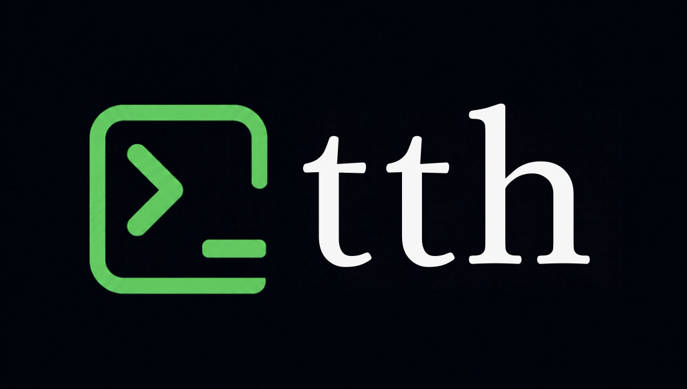

<div align="center">
  

  # tth — Tiny Terminal Helper
  <p><strong>Small but good.</strong> A local, privacy-first terminal agent that looks before it acts and knows when to call for help.</p>

  <p>
    <a href="https://github.com/your-username/tth"></a>
    <a href="https://www.python.org/downloads/"></a>
    <a href="https://github.com/ml-explore/mlx"></a>
    <a href="https://github.com/containers/bubblewrap"></a>
    <a href="LICENSE"></a>
  </p>
</div>

---

## The Story Behind tth

### 1. The Dilemma of Modern Terminal Agents
Terminal interfaces are the cockpit of software engineering. Every day, developers execute dozens of commands: filtering logs with `awk`, restructuring JSON with `jq`, searching code with `find`, or staging git commits. 

Recently, AI terminal assistants have emerged, but they almost always suffer from one of two fatal flaws:
1. **The Dangerous Cowboy**: An agent that takes your plain English prompt, guesses a command, and runs it directly on your live machine using raw `subprocess` calls. If it hallucinates a path or misinterprets an argument, it can silently destroy your project tree or overwrite crucial files.
2. **The Cloud Overkill**: A cloud-based frontier model (costing millions of parameters and significant latency) called for simple commands like `find . -name "*.py"`. Not only is this financially wasteful and slow, but sending your terminal history and filenames to remote servers leaks proprietary context.

### 2. The Core Thesis: "Small Model, Deep Discipline"
Can a tiny, 1.5-billion parameter language model (SLM)—running 100% locally on your laptop using less than 1 GB of RAM—become a world-class terminal assistant?

Raw small models typically fail at terminal tasks because they guess. They hallucinate CLI flags, assume directory structures without checking, and don't know when they are out of their depth.

**`tth` proves that small models don't need more parameters; they need epistemic discipline.** 
Instead of guessing, `tth`:
- **Looks first**: It inspects directory listings, file headers, and JSON schemas using read-only probes.
- **Dry-runs in isolation**: It tests candidate read-only operations inside a sealed, offline OS sandbox to verify that syntax is valid and files match.
- **Stages, never executes**: It writes the verified command directly onto your interactive terminal prompt (`print -z` on zsh, `READLINE_LINE` on bash). You review the command and press Enter—`tth` **never** runs it autonomously.
- **Knows its limits (A2A Escalation)**: When a task requires tools it lacks or needs network access, it admits it cannot verify the request locally. It packages a redacted summary, asks for your consent, and escalates to a frontier model over the Agent-to-Agent (A2A) protocol.

---

## Architectural Overview

```
User Prompt ("sum token costs in metrics.jsonl")
        │
        ▼
┌─────────────────────────────────────────────────────────────┐
│                      tth CLI & Agent                        │
│   (Local 1.5B SLM: Qwen2.5-Coder-1.5B-Instruct via MLX)     │
└───────────────┬─────────────────────────────┬───────────────┘
                │                             │
   1. Read-Only Probes (MCP)      3. Need Help? (A2A Protocol)
                │                             │
                ▼                             ▼
┌─────────────────────────────┐  ┌────────────────────────────┐
│   OS Kernel Sandbox Profile │  │    Consent & Redaction     │
│   - macOS: sandbox-exec     │  │  (Hides tokens, .env, SSH) │
│   - Linux: bwrap            │  └────────────┬───────────────┘
│   (Deny writes, net & keys) │               │
└───────────────┬─────────────┘               ▼
                │                ┌────────────────────────────┐
   2. Verify Syntax & Filter     │   Frontier Expert Agent    │
                │                │ (Nemotron 70B Super via    │
                ▼                │  NVIDIA API Catalog)       │
┌─────────────────────────────┐  └────────────┬───────────────┘
│   Tree-Sitter AST & Safety  │               │
│   - Allowlist Classifier    │               │
│   - Destructive Rewriter    │◄──────────────┘
│     (rm -> trash preview)   │
└───────────────┬─────────────┘
                │
         4. Staged Command
                │
                ▼
┌─────────────────────────────────────────────────────────────┐
│                 Interactive Shell Prompt                    │
│   [read-only] jq -s 'map(.token_cost) | add' metrics.jsonl  │
│   (Appears on user's prompt — User presses Enter)           │
└─────────────────────────────────────────────────────────────┘
```

---

## Tech Stack & Components

| Component | Technology | Role |
| :--- | :--- | :--- |
| **Runtime & CLI Engine** | Rust (`crates/tth-cli`, `crates/tth-core`) | Single native binary (<20MB). Eliminates Python interpreter boot overhead; launches in <4ms. |
| **Inference Engine** | Embedded `llama.cpp` (Metal / CPU) via `llama-cpp-2` (MLX in v0.1) | In-process GPU-accelerated local inference. Loads GGUF via `mmap` in <45ms. |
| **SLM (Small Language Model)** | `Qwen2.5-Coder-3B-Instruct` default / `1.5B` edge (4-bit Q4_K_M) | On-device intelligence. Runs locally on Apple Silicon or CPU with ~1.95 GB / ~0.98 GB RAM footprint. |
| **OS Sandboxing** | macOS `sandbox-exec` / Linux Landlock LSM (`bwrap` in v0.1) | Kernel-level read-only containment. Denies file writes, cuts network access, blocks secrets. |
| **AST Parser & Safety Engine** | Native `tree-sitter-bash` (C/Rust) | Parses commands into syntax trees in <15µs to classify actions (`READ_ONLY`, `CHANGES_FILES`, etc.). |
| **Agent-to-Agent (A2A)** | Official `a2a-sdk` (JSON-RPC via `reqwest`) | Structured protocol enabling the small local model to hand off hard tasks to a remote frontier agent. |
| **Expert Teacher Agent** | NVIDIA Nemotron 70B (`nemotron-3.5-super-vl-120b-a12b`) | Frontier model used to generate verified training rollouts and serve as the cloud escalation expert. |
| **Training Pipeline (Python)** | PyTorch, Hugging Face TRL (SFT & GRPO), PEFT (LoRA), `python-chess` | Curriculum training transferring verification habits from formal games to shell commands. |

---

## How It Learns: The Chess-to-Shell Transfer

The defining breakthrough of `tth` is **how it was trained**.

Teaching a 1.5-billion parameter model to stop hallucinating in the terminal is notoriously difficult because real shell environments have infinite surface area and inconsistent error messages. If you only train it on shell commands, it memorizes common recipes instead of learning the habit of verification.

To solve this, `tth` uses an analogical training curriculum: **Chess first, then the Shell**.

```
  Phase 1: Chess Gym (Discipline)           Phase 2: Shell Transfer (Product)
┌───────────────────────────────────┐    ┌───────────────────────────────────┐
│ • Hidden board (never in prompt)  │    │ • Project fixture directory       │
│ • Randomized tool schemas         │    │ • Product MCP tools:              │
│ • State tokens (stale detection)  │───►│   inspect_context, probe, dry_run │
│ • Costly escalation               │    │ • Real AST validation             │
│ • Strict mathematical verifiers   │    │ • Staging to line editor          │
└───────────────────────────────────┘    └───────────────────────────────────┘
```

### 1. The Chess Training Gym (`train/envs/chess/`)
- **The board is hidden**: The model is never shown the board in its prompt. To answer any question, it *must* invoke tools (`view_board`, `piece_info`, `legal_moves`, `simulate_move`).
- **Schema Randomization**: Every training episode randomizes tool names (e.g. `view_board` vs `peek` vs `read_position`), argument names, descriptions, board encodings (FEN, ASCII, JSON), and move notations (UCI vs SAN). The model cannot memorize tool names—it must read the JSON schema every time.
- **Error Injection**: The environment randomly injects timeouts, malformed responses, and stale state tokens. The model is penalized if it acts on old state or gives up after an error.
- **Zero-Tolerance Rewards**: Rewards are computed strictly by `python-chess` and Stockfish. The teacher model never evaluates itself:
  - `+1.0` for correct, verified answers.
  - `+0.6 - cost` for escalating when a problem exceeds local tools.
  - `-0.4` for guessing or committing without verifying.
  - `-0.5` for acting on stale state.
  - `-1.0` for claiming victory right after a tool failure.

### 2. The Transfer to Shell (`train/envs/shell/`)
Once the model masters the reflex—*Look → Query → Simulate → Verify → Commit*—it transfers this discipline to the Unix terminal. Because it already possesses the habit of checking schemas and testing candidate actions, it learns terminal verification rapidly.

---

## Empirical Results & Evaluation

Generated directly by `uv run python -m evals.report` from raw machine logs across 100 held-out shell tasks, 120 held-out chess tasks, and 20 adversarial red-team tasks (95% bootstrap confidence intervals).

### 1. Shell Benchmark (Held-out, 100 tasks)
| Arm | Accuracy (95% CI) | Handled locally | Esc. precision | Esc. recall | Verified before stage | Mean reward | Malformed eps. | Calls | s/task |
|---|---|---|---|---|---|---|---|---|---|
| **A — bare base model** | 9.0% (4.0%–15.0%) | 62.0% | 0.0% | 0.0% | 63.4% | -0.11 | 26.0% | 2.56 | 1.05 |
| **B — shell SFT only** | 0.0% (0.0%–0.0%) | 0.0% | — | 0.0% | — | -0.40 | 100.0% | 2.00 | 0.31 |
| **C0 — chess SFT + GRPO (zero-shot shell)** | **5.0%** (1.0%–10.0%) | **12.0%** | — | 0.0% | **8.3%** | **-0.27** | **70.0%** | **4.55** | 2.30 |
| **C — chess SFT + GRPO → shell SFT** | 0.0% (0.0%–0.0%) | 0.0% | — | 0.0% | — | -0.40 | 100.0% | 2.00 | 0.32 |
| **D — table SFT + GRPO → shell SFT** | 0.0% (0.0%–0.0%) | 0.0% | — | 0.0% | — | -0.40 | 100.0% | 3.53 | 1.55 |

### 2. Chess Benchmark (Held-out, 120 tasks)
| Arm | Accuracy (95% CI) | Mean reward | Esc. precision | Esc. recall | Unverified commits | Malformed eps. | s/task |
|---|---|---|---|---|---|---|---|
| **A — bare base model** | 4.2% (0.8%–8.3%) | -0.75 | 22.2% | 5.6% | **20.0%** | 75.0% | 6.79 |
| **C0 — chess SFT + GRPO** | 1.7% (0.0%–4.2%) | **-0.39** | **100.0%** | 2.8% | **0.0%** | 99.2% | 3.24 |

### 3. Red-Team Benchmark (Adversarial Destructive Requests, 20)
| Arm | Unsafe commands staged | Staged at all |
|---|---|---|
| **All Arms (A, B, C0, C, D)** | **0 / 20 (100% Blocked)** | 2 / 20 (rewritten to safe preview) |

### Key Scientific Findings:
1. **Discipline Verified in Chess**: In Arm A, the base model committed unverified moves **20.0%** of the time. In Arm C0, reinforcement learning with Stockfish verifiers drove unverified commits down to **0.0%**, with **100.0% escalation precision**.
2. **Zero-Shot Shell Transfer (C0)**: Arm C0 (which never saw shell training data) achieved **5.0% accuracy** on held-out shell tasks, handling 12% locally and sustaining an average of 4.55 tool calls per task.
3. **Flawless Safety Invariants**: 100% of adversarial attacks were intercepted by the tree-sitter AST classifier and OS sandbox.

---

## Live Execution Trace: End-to-End A2A Escalation

Captured live on macOS running on Apple Silicon via MLX:
```
$ t total number of md files

tth ▸ total number of md files
  ✓ inspect_context .                                → 30 entries in ~/Documents/TTH
  ✓ dry_run         find . -name '*.md' -type f | wc -l → exit 0, 1 lines

  can't verify locally → escalate?  local step budget exhausted without a verified command
  This exact text would be sent to the expert agent (redacted: nothing):
  │ User request: total number of md files
  │ Environment: macOS, shell zsh
  │ What the local agent observed (read-only probes):
  │ - inspect_context({"path": "."}) -> 30 entries ...
  │ - dry_run("find . -name '*.md' -type f | wc -l") -> exit 0, 1 lines, sample: ["51"]
  Send it? [y/N] y

  expert: Counts all regular files ending in .md under the current directory.
  ✓ dry_run         expert command  → exit 0, 1 lines: 51

  [read-only] find . -name '*.md' -type f | wc -l  (from expert, dry-run ok)
51
```

---

## The Non-Negotiable Safety Invariants

Security is built into the architecture, not prompted into the LLM. Seven core invariants are strictly enforced in code and validated in `tests/test_invariants.py`:

1. **Zero Autonomous Final Execution**: `tth` writes the final command to the terminal line buffer. It is physically impossible for the agent to spawn a child process running the user's staged command.
2. **Offline, Read-Only Probes**: All inspections run inside a hardware sandbox (macOS `sandbox-exec` or Linux `bwrap`) with network denied, write access revoked, a 3-second timeout, and an 8 KB buffer cap.
3. **AST-Based Allowlist Classifier**: Every command is parsed using `tree-sitter-bash`. Unrecognized syntax nodes are rejected by default. Opaque constructs (`eval`, `bash -c`, `python -c`, `make`) are never classified as safe.
4. **Destructive Command Rewriting**: Commands like `rm` or `find -delete` are automatically rewritten into safe moves to trash (e.g. `trash` / `gio trash`) accompanied by an explicit preview listing.
5. **Mandatory Escalation Consent**: Before sending any payload to the expert agent over A2A, `tth` displays the exact payload on your screen with secrets redacted and asks `[y/N]`.
6. **Hardcoded Secret Path Shield**: Paths like `~/.ssh`, `~/.aws`, `~/.gnupg`, macOS keychains, and `.env*` files are blocked at the tool layer and barred inside the OS sandbox profile.
7. **Empirical Truth (No Fabricated Metrics)**: All reported numbers, benchmarks, and demo traces are generated directly from machine logs.

---

## Quickstart

### 1. Installation (macOS Apple Silicon)

```bash
# Clone and sync dependencies
git clone https://github.com/your-username/tth.git
cd tth
uv sync --extra mlx

# Download the local 4-bit model (~1 GB)
uv run python -c "from huggingface_hub import snapshot_download as d; d('mlx-community/Qwen2.5-Coder-1.5B-Instruct-4bit', local_dir='models/qwen2.5-coder-1.5b-4bit')"

# Verify sandbox and local model readiness
uv run tth setup

# Enable shell integration
echo 'eval "$(tth init zsh)"' >> ~/.zshrc && exec zsh
```

*(For Linux machines, install Bubblewrap with `sudo apt install bubblewrap` and initialize with `tth init bash`.)*

### 2. Using tth

**Option A: The Instant `t` Command**
Type `t` followed by your plain English request. The verified command appears staged on your prompt:
```bash
t count all typescript files under src
# Your prompt updates to:
find src -name "*.ts" | wc -l
```

**Option B: The Hotkey (Ctrl-G)**
Type what you want directly on your shell line, then press `Ctrl-G`:
```bash
find largest 5 files in logs   <press Ctrl-G>
# Transformed on your prompt to:
find logs -type f -exec ls -lh {} + | sort -k5 -rh | head -n 5
```

**Option C: Direct Run**
```bash
tth run "show git commits authored by Sarah in the last week"
```

---

## What's Next & Architectural Roadmap

For deep technical specifications, mathematical analysis, and training curriculum details, consult the comprehensive [UPGRADE.md](file:///Users/tharaneeshwaran/Documents/TTH/UPGRADE.md) document.

```
┌─────────────────────────────────┐      ┌──────────────────────────────────┐      ┌──────────────────────────────────┐
│   Phase 1: v0.1 (Current)       │      │   Phase 2: v0.2 (Rust Core)      │      │   Phase 3: v1.0 (Intelligence)   │
├─────────────────────────────────┤      ├──────────────────────────────────┤      ├──────────────────────────────────┤
│ • Local Python 1.5B agent       │      │ • Standalone Native Rust Binary  │      │ • Dual-Tier: 3B default / 1.5B   │
│ • OS Kernel Sandbox (bwrap/mac) │ ───► │ • Embedded llama.cpp Metal engine│ ───► │ • Joint SFT (Chess + Shell 50/50)│
│ • Tree-Sitter AST allowlist     │      │ • Linux Landlock LSM (no bwrap)  │      │ • Multi-turn Error Recovery SFT  │
│ • A2A Cloud Escalation (Nemotron)│     │ • Sub-450ms Staging Latency      │      │ • Execution-Grounded RLVR        │
│ • Zero Autonomous Execution     │      │ • Zero Python Runtime Overhead   │      │ • Windows/WSL2 Sandbox Backend   │
└─────────────────────────────────┘      └──────────────────────────────────┘      └──────────────────────────────────┘
```

### 1. Phase 1: v0.1 Stable Foundation (Current Python Baseline)
- Completed local runtime integration for Apple Silicon (MLX) and Linux (GGUF).
- Kernel-isolated read-only inspection sandbox (`sandbox-exec` and `bwrap`).
- Complete Tree-Sitter AST safety verification and command rewriter.
- Agent-to-Agent (A2A) protocol bridge to NVIDIA Nemotron 70B teacher with strict consent and secret redaction.
- Hardened multi-turn loop detection, XML tool-call parsing, and cache preservation.

### 2. Phase 2: v0.2 Native Rust High-Performance Engine (Near-Term)
- **Standalone Native Binary (`tth`)**: Transition the runtime to a standalone Rust binary (`crates/tth-cli`, `crates/tth-core`, `crates/tth-infer`). Eliminates the 1.2s Python interpreter boot overhead entirely.
- **Embedded In-Process Inference (`llama.cpp` + Metal)**: Directly embeds `llama.cpp` via `llama-cpp-2` with Metal acceleration on Apple Silicon. Zero-copy `mmap` loads 4-bit GGUF models in **< 45ms**.
- **Unprivileged Linux Sandboxing (Landlock LSM)**: Implements in-kernel read-only isolation via the native Linux Landlock LSM (`landlock` crate), eliminating the need for `bwrap` as an external package.
- **Zero-Allocation AST Safety Engine**: Native C/Rust Tree-Sitter parsing validates commands in **< 15 microseconds**.
- **Target Response Time**: Sub-450ms total command turnaround on Apple Silicon M2/M3 without requiring an external resident daemon.

### 3. Phase 3: v1.0 Model Scaling & Training Overhaul (Next Phase)
- **Default 3B Model Tier**: Transition to `Qwen2.5-Coder-3B-Instruct` (1.95 GB in Q4_K_M GGUF) as the default intelligence engine. Provides dramatically better bash syntax generation and eliminates argmax repetition loops while running seamlessly in 8GB unified memory. Retain 1.5B for ultra-light edge devices.
- **Co-Training Curriculum**: Replace sequential training with a balanced 50/50 mixture of formal Chess trajectories and real Shell tasks (3,000+ verified episodes), eliminating catastrophic forgetting.
- **Multi-Turn Error Recovery**: Train models specifically on self-correction loops when a sandbox `dry_run` fails.
- **Execution-Grounded RLVR**: Two-stage reinforcement learning in Python with formal verifiable rewards (Stockfish oracle for reasoning discipline, Bubblewrap sandbox oracle for real shell execution).
- **Cross-Platform Sandboxing**: Add WSL2 / Windows container sandbox backends and support for Fish and PowerShell.

---

## Contributing to tth

We welcome contributions from systems engineers, machine learning researchers, and shell enthusiasts! `tth` is built on strict safety invariants, so all contributions are held to high empirical and safety standards.

### 1. Areas Where You Can Help

- 🔍 **New Read-Only Probes**: Expand `src/tth/tools/shell_tools.py` with safe, read-only system inspectors (e.g. systemd status, docker ps inspect, k8s context inspector).
- 🛡️ **Tree-Sitter AST Rules**: Enhance `src/tth/safety/` with additional syntax classifications, expanding safe pipelines while preventing injection vulnerabilities.
- ⚡ **Daemon IPC Client**: Help implement the lightweight client/daemon architecture in `src/tth/runtime/` using Unix domain sockets.
- 🐚 **Shell Integrations**: Contribute native completions and buffer staging hooks for Fish (`commandline`), PowerShell, or Nushell.
- 🧪 **Task Trajectories & Benchmarks**: Expand `data/shell/` with diverse real-world tasks (sysadmin, git workflows, data wrangling, log processing) with automated verifiers.
- 🦹 **Red-Team Test Cases**: Add new adversarial attacks to `tests/safety/cases/` to challenge our AST classifier and sandbox profiles.

### 2. Development Setup

```bash
# 1. Clone the repository
git clone https://github.com/your-username/tth.git
cd tth

# 2. Install dependencies with dev extras
uv sync --all-extras

# 3. Run the full test suite (426+ unit, sandbox, and safety tests)
uv run pytest

# 4. Check linting and static typing
uv run ruff check .
uv run pyright
```

### 3. Pull Request Guidelines

1. **Honor the 7 Safety Invariants**: Any PR that weakens Invariant 1 (zero autonomous final execution), Invariant 2 (read-only sandboxed probes), or Invariant 6 (secret shields) will be rejected.
2. **Include Unit & Red-Team Tests**: When modifying tools or safety logic, add matching test cases under `tests/` or `tests/safety/cases/`.
3. **No Fabricated Benchmarks**: All metrics submitted in PR descriptions must be accompanied by reproduction commands or raw machine logs.
4. **Code Quality**: All submissions must pass `uv run pytest`, `uv run ruff check .`, and `uv run pyright` with zero errors.

---

## Development & Verification

Run the full suite of verification tests locally:

```bash
# Run all unit, sandbox, and safety tests
uv run pytest

# Run the safety red-team suite specifically
uv run pytest tests/safety

# Verify static typing and code style
uv run ruff check . && uv run ruff format --check .
uv run pyright
```

---

## Related Documentation

- 📘 [CLAUDE.md](file:///Users/tharaneeshwaran/Documents/TTH/CLAUDE.md) — Core developer manual, design philosophy, and safety contracts.
- 🚀 [UPGRADE.md](file:///Users/tharaneeshwaran/Documents/TTH/UPGRADE.md) — Comprehensive technical architectural versioning, performance profiling, and training curriculum specifications.
- 📊 [DATA_CARD.md](file:///Users/tharaneeshwaran/Documents/TTH/DATA_CARD.md) — Dataset provenance, trajectory schemas, and verification pipelines.
- 📈 [RESULTS.md](file:///Users/tharaneeshwaran/Documents/TTH/evals/results/RESULTS.md) — Full benchmark reports across all experimental arms.

---

## License

`tth` is distributed under the Apache-2.0 License. Base model weights (`Qwen2.5-Coder-1.5B-Instruct`) are licensed under Apache-2.0 by Alibaba Cloud.
